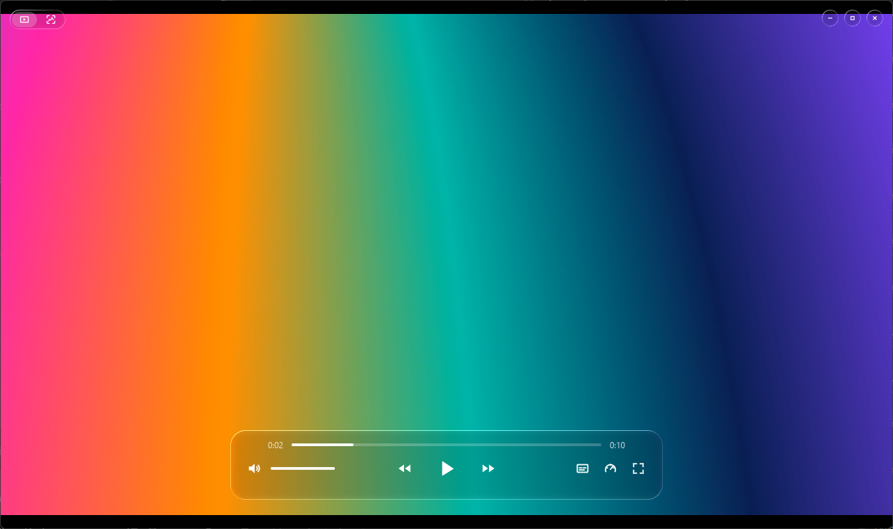
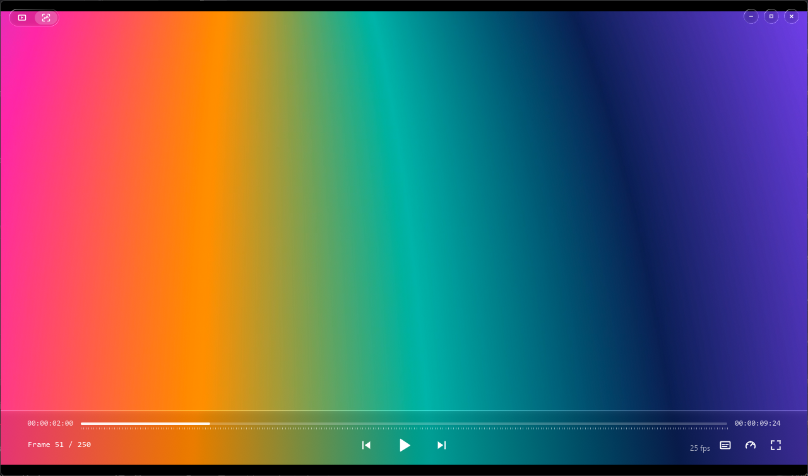

<p align="center">
  
</p>

<h1 align="center">StarPlay</h1>

<p align="center">
  A clean, fast video player for Windows — with a frame-accurate checking mode.<br>
  Plays everything FFmpeg plays, including heavy ProRes, in true HDR.
</p>

<p align="center">
  <a href="https://github.com/adriendelmas/StarPlay/releases/latest"><b>Download for Windows</b></a>
</p>



## Why StarPlay

Most players are either pleasant to watch with, or useful to check a render with. StarPlay is both, in the same window, with one engine: switch modes at any time without reloading the video, losing your position or interrupting the sound.

- **Player mode** — a minimal floating control bar in liquid glass that gets out of the way after 2.5 s.
- **Checking mode** — frame numbers, timecode, exact frame seeking, a zoomable timeline and a YouTube-style precision scrub with a filmstrip of neighbouring frames.

## Features

**Playback**
- Built on [libmpv](https://mpv.io) and FFmpeg: every codec and container, ProRes 422/4444 included, hardware decoding where available.
- Direct3D 11 output with HDR: HDR10 is sent as HDR to an HDR display, tone-mapped otherwise.
- No dropped frames on a 4K ProRes HQ 30 fps file (845 Mb/s) on a desktop machine.

**Interface**
- Real liquid glass: the controls refract and blur the actual video underneath (a GPU shader running inside mpv), no fake noise texture.
- Frameless window with its own glass window buttons, Windows 11 rounded corners, snap and shadow kept.
- Controls and cursor hide on their own; drag the picture to move the window, drag the edges to resize.
- Drop a file anywhere, or pick one from the recent files on the start screen.
- Subtitle and audio track menus, speed control, volume on the mouse wheel.

**Checking mode**
- Frame number (counted from 1, like Nuke and RV) and HH:MM:SS:FF timecode, always visible.
- Exact seeking: the frame you aim at is the frame you get (verified against FFmpeg), not the nearest keyframe.
- Hover the timeline for a preview of the exact frame under the mouse, with its number and timecode.
- Drag on the timeline, then move the mouse up: the glass rises into a filmstrip of neighbouring frames that scrolls with your hand; the higher you go, the bigger the frames and the finer the control. The cursor hides and stays in the window so you can scroll endlessly.
- Mouse wheel on the timeline = one frame; Ctrl + wheel zooms the timeline around the mouse.
- Type a frame number or a timecode to jump straight to it.
- Houdini-style speed field: drag to change the value, move up for coarser steps, click to type.



## Install

1. Download `StarPlay-<version>-setup.exe` from the [latest release](https://github.com/adriendelmas/StarPlay/releases/latest).
2. Run it. It installs for your user only (no administrator rights) in `%LOCALAPPDATA%\Programs\StarPlay`, adds a Start menu entry and an uninstaller in *Settings > Apps*.
3. To make StarPlay your default video player, tick *Choose StarPlay as my default video player* at the end of the setup, or go to *Settings > Apps > Default apps > StarPlay*. StarPlay also appears in *Open with* for every video file.

Requirements: Windows 10 or 11, 64-bit, a GPU with Direct3D 11 and OpenGL drivers. Windows may warn about an unknown publisher because the installer is not code-signed yet.

## Keyboard and mouse

| Key | Action |
|---|---|
| Space, `p` | Play / pause |
| ← / → | −5 s / +5 s (checking mode: one frame; Shift: one second) |
| ↑ / ↓ | +1 min / −1 min |
| `,` / `.` | Previous / next frame |
| `[` / `]` | Speed down / up (0.25× to 4×) |
| Backspace | Speed back to 1× |
| `9` / `0`, `/` / `*` | Volume −2 / +2 |
| `m` | Mute |
| `j` / `#` | Next subtitle / audio track |
| `f`, Esc | Fullscreen / leave fullscreen |
| Tab | Switch player / checking mode |
| `g` | Go to a frame or timecode (checking mode) |
| Ctrl+O | Open a file |
| `i` | Technical info (decoder, colour space, dropped frames) |
| `q` | Quit |

Mouse: click the picture to play or pause, double-click for fullscreen, wheel for volume, drag the picture to move the window. Shortcuts follow [mpv](https://mpv.io/manual/stable/#keyboard-control) and work on any keyboard layout.

## Build from source

1. **Microsoft C++ build tools**: [Build Tools for Visual Studio](https://visualstudio.microsoft.com/visual-cpp-build-tools/) with the *Desktop development with C++* workload (MSVC + Windows SDK).
2. **Rust**: install with [rustup](https://rustup.rs) (`stable-x86_64-pc-windows-msvc`).
3. **libmpv**: from the repository root, run

   ```powershell
   powershell -ExecutionPolicy Bypass -File scripts/get-mpv.ps1
   ```

   It downloads the mpv development package from [shinchiro/mpv-winbuild-cmake](https://github.com/shinchiro/mpv-winbuild-cmake/releases) into `vendor/mpv/` and generates the `mpv.lib` import library for MSVC. Add `-Variant x86_64-v3` for a build that needs an AVX2 CPU.
4. **Build**:

   ```powershell
   cargo build --release
   ```

   `libmpv-2.dll` and the glass shader are copied next to `target/release/starplay.exe`. The C runtime is linked statically, so nothing else is needed on the target machine.
5. **Installer** (optional, needs [NSIS 3](https://nsis.sourceforge.io)):

   ```powershell
   powershell -ExecutionPolicy Bypass -File scripts/build-installer.ps1 -Makensis "C:\path\to\makensis.exe"
   ```

   The setup is written to `target/StarPlay-<version>-setup.exe`.

Any `--option=value` on the command line is passed to mpv, e.g. `starplay.exe video.mov --hwdec=no`.

## How it works

- A plain Win32 window hosts mpv, which renders with `vo=gpu-next` on Direct3D 11 (HDR-aware).
- The Slint interface is a separate transparent, frameless window owned by the video window and kept on top of it. It never takes keyboard focus; keys are handled by the video window.
- The liquid glass is a libplacebo user shader (`shaders/glass.glsl`) applied by mpv to the final image; the interface sends it the position, size and opacity of each glass shape whenever they change.
- Frame previews come from a second, invisible mpv instance that seeks exactly and renders a 320 px frame in software.

## Credits and license

StarPlay is released under the [GPL-3.0-or-later](LICENSE). It stands on [mpv](https://mpv.io), [FFmpeg](https://ffmpeg.org) and [Slint](https://slint.dev); see [CREDITS.md](CREDITS.md) for every component and its license.
